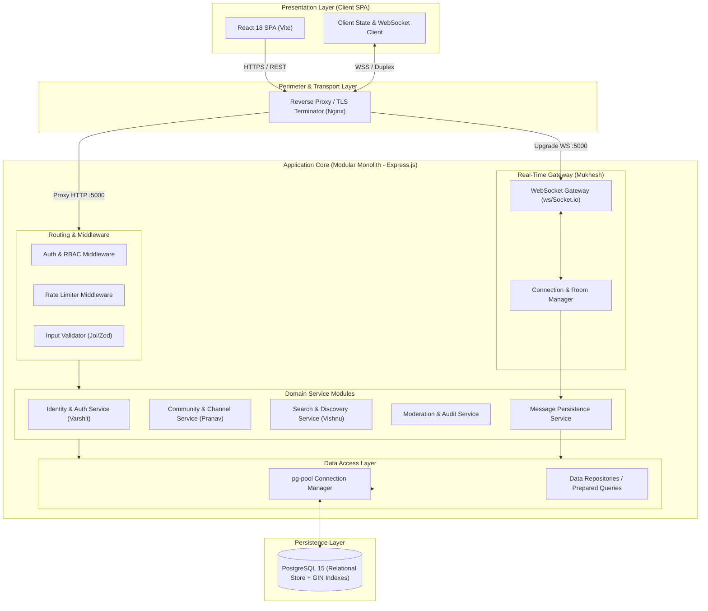
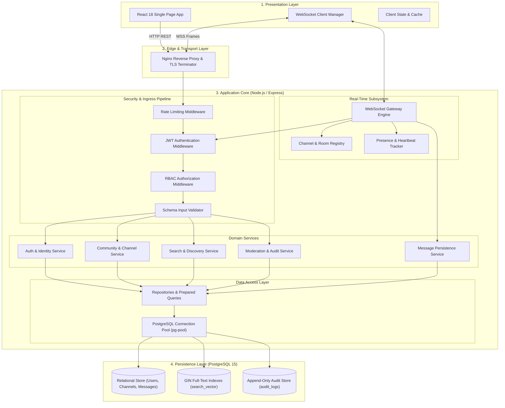
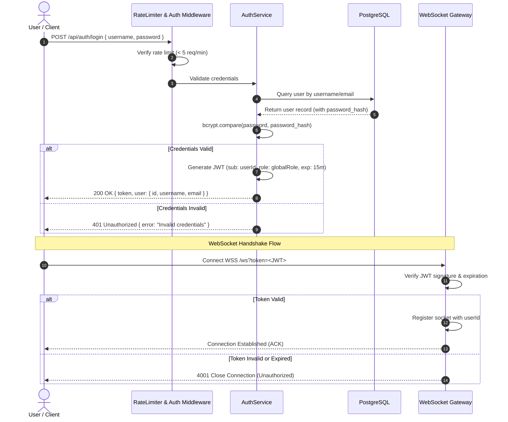
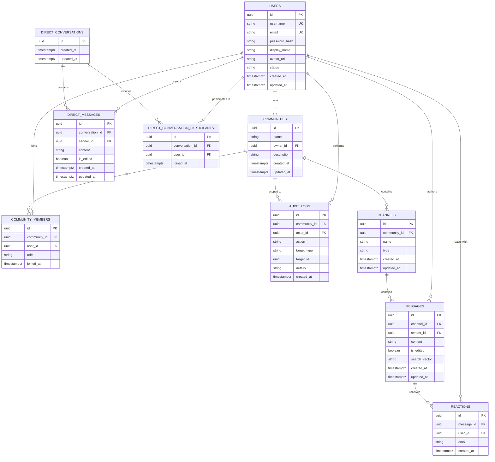

# Software Architecture Document (SAD)
## NexusChat Real-Time Communication Platform
**Document Identifier:** SAD-NEXUS-01  
**Standard Compliance:** IEEE 1016-2009 (Standard for Information Technology — Systems Design — Software Design Descriptions)  
**Project:** SE Mini-Project Part 1 — Deliverable 3 (Part A: Architecture Specification)  
**Author:** Vishnu Anand (PES1UG24CS537)  
**Repository:** `VG776/SE-Jackfruit`  
**Target Branch:** `Vishnu-arch-design-docs`  
**Status:** Approved Draft  
**Date:** October 2026  

---

## 1. Introduction

### 1.1 Purpose
This Software Architecture Document (SAD) provides a comprehensive architectural overview of the **NexusChat** system using the IEEE 1016-2009 Software Design Description standard. It defines the high-level structural decomposition, component responsibilities, communication protocols, security safeguards, persistent data models, and deployment topology. This document serves as the primary technical specification for developers, quality assurance engineers, and system evaluators, translating the requirements defined in the *NexusChat Software Requirements Specification (SRS)* into robust, verifiable software designs.

### 1.2 Scope
This architecture covers the entire Minimum Viable Product (MVP) scope of NexusChat as mandated in the SRS:
- **Identity & Access Management:** User registration, credential authentication, profile management, and token-based session lifecycle.
- **Community & Channel Governance:** Community creation, role-based permission delegation, text channel management, and server-side authorization enforcement.
- **Real-Time Communication:** Persistent channel text messaging, one-to-one direct messaging (DM), live event dispatching over WebSockets, message edit/delete lifecycles, and ephemeral presence/typing indicators.
- **Discovery, Engagement & Quality:** Full-text message search with PostgreSQL GIN indexing, message reactions, unread message tracking, and administrative moderation with immutable audit logging.
- **Non-Functional Boundaries:** Sub-500 ms p95 WebSocket acknowledgements, sub-2 second query responses, Docker containerization, and zero-trust security controls.

### 1.3 Definitions, Acronyms, and Abbreviations
| Term / Acronym | Definition |
|---|---|
| **API** | Application Programming Interface |
| **Bcrypt** | Adaptive, salted cryptographic password hashing function based on the Blowfish cipher |
| **DAL** | Data Access Layer |
| **DM** | Direct Message (private one-to-one communication stream) |
| **ERD** | Entity-Relationship Diagram |
| **FR** | Functional Requirement (defined in SRS Section 5) |
| **GIN** | Generalized Inverted Index (PostgreSQL indexing mechanism for fast full-text search) |
| **IEEE 1016** | IEEE Standard for Information Technology — Systems Design — Software Design Descriptions |
| **JWT** | JSON Web Token (RFC 7519) |
| **NFR** | Non-Functional Requirement (defined in SRS Section 6) |
| **RBAC** | Role-Based Access Control |
| **REST** | Representational State Transfer |
| **RTM** | Requirement Traceability Matrix |
| **SAD** | Software Architecture Document |
| **SPA** | Single Page Application |
| **SRS** | Software Requirements Specification (NexusChat SRS Working Draft) |
| **STRIDE** | Threat modeling framework (Spoofing, Tampering, Repudiation, Information Disclosure, Denial of Service, Elevation of Privilege) |
| **TLS/WSS** | Transport Layer Security / WebSocket Secure |
| **tsvector** | PostgreSQL sorted list of distinct lexemes for linguistic full-text indexing |
| **UTC** | Coordinated Universal Time |

### 1.4 References
1. *NexusChat Software Requirements Specification (SRS_document.md)* — Working Draft, October 2026.
2. *IEEE Std 1016-2009: IEEE Standard for Information Technology — Systems Design — Software Design Descriptions*.
3. *RFC 7519: JSON Web Token (JWT)*, Internet Engineering Task Force (IETF).
4. *RFC 6455: The WebSocket Protocol*, Internet Engineering Task Force (IETF).
5. *OWASP Top 10:2021 — The Ten Most Critical Web Application Security Risks*.
6. *PostgreSQL 15 Documentation: Chapter 12 Full Text Search*.

### 1.5 System Overview
NexusChat is engineered as a responsive, cloud-native collaborative chat platform structured around a modern **Client-Server architecture with a Modular Monolithic backend core and an Event-Driven real-time subsystem**. Clients communicate via HTTPS REST interfaces for transactional management operations and duplex WebSocket connections (WSS) for instant event delivery. Persistent state is centralized in PostgreSQL 15, managed through relational constraints and specialized search indexes.

---

## 2. Architectural Representation & Style

### 2.1 Architecture Pattern Selection & Justification
NexusChat adopts a **Modular Monolithic Layered Architecture with an Asynchronous Event-Driven Messaging Core**:



#### Justification Against SRS Requirements:
1. **Low Latency & High Throughput (SRS Section 6.1):** Achieving sub-500 ms p95 message delivery acknowledgement requires persistent TCP sockets and minimal serialization hops. Co-locating the WebSocket connection manager and relational persistence service within a single Node.js runtime process eliminates cross-network RPC latency, serialization overhead, and distributed lock delays.
2. **ACID Transactional Consistency (FR-COM-01, FR-COM-04, FR-MOD-01, FR-MOD-03):** Operations involving community creation, membership alterations, channel deletion, and security audit writes demand strict atomicity. Centralizing transactions within PostgreSQL eliminates two-phase commit overhead and distributed data inconsistencies.
3. **Team Boundary Alignment:** The codebase maps cleanly to module ownership:
   - *Identity & Auth:* `backend/src/services/authService.js` (Varshit)
   - *Community & Channels:* `backend/src/services/communityService.js` (Pranav)
   - *Real-time Messaging:* `backend/src/services/messagingService.js` + WebSocket Gateway (Mukhesh)
   - *Search & Quality:* `backend/src/services/searchService.js` + Test Infrastructure (Vishnu)

### 2.2 Trade-offs and Rejected Alternatives

| Architectural Style | Evaluation | Decision & Rationale |
|---|---|---|
| **Microservices Architecture** | High operational complexity, requires service discovery, distributed tracing, complex Docker Compose setup, and distributed transactions (Saga pattern) across services. | **REJECTED.** Unjustified operational tax for an academic MVP. Network latency between microservices would jeopardize the sub-500 ms p95 acknowledgement target (SRS Section 6.1). |
| **Traditional Request-Response MVC** | Pure HTTP request-response with polling. | **REJECTED.** Inability to satisfy real-time broadcast requirements (FR-MSG-02) and typing/presence updates (FR-MSG-05) without crippling server polling overhead. |
| **Peer-to-Peer (WebRTC Direct)** | Direct client-to-client data channels. | **REJECTED.** Violates mandatory server-side permission checks (FR-COM-04), message persistence (FR-MSG-02), centralized search indexing (FR-UX-02), and immutable audit trails (FR-MOD-03). |
| **Modular Monolith + Event Core** | High developer velocity, single deployable container, co-located memory access, single source of truth in PostgreSQL, clean module boundaries. | **SELECTED.** Optimal balance of performance, simplicity, maintainability, and strict adherence to SRS requirements. |

---

## 3. Component View & Architecture Decomposition

### 3.1 Component Diagram
The structural breakdown of software components, layers, and operational connections is rendered below:



### 3.2 Component Responsibilities

#### 1. Presentation Layer (React 18 SPA)
- **Role:** Executes in user browser; renders responsive UI components for authentication, communities, channels, message streams, search modals, and moderation controls.
- **Key Sub-modules:**
  - `AuthContext`: Manages active user authentication state and in-memory tokens.
  - `WebSocketClient`: Manages WSS lifecycle, automatic reconnection with exponential backoff, room join/leave frames, and ping/pong heartbeats.
  - `MessageTimeline`: Renders virtualized, XSS-sanitized message lists, reaction badges, and edit badges.
  - `SearchBar & SearchResults`: Debounced search query dispatcher, filter controllers, and highlighted result renderer.

#### 2. Reverse Proxy & Perimeter (Nginx)
- **Role:** Handles TLS termination (HTTPS/WSS), serves static assets, provides initial rate-limiting bursts, and reverse-proxies API requests and WebSocket upgrades to the Node.js backend.
- **Configuration:** Restricts upload size, injects secure HTTP headers (`Strict-Transport-Security`, `X-Frame-Options: DENY`, `X-Content-Type-Options: nosniff`).

#### 3. Ingress Middleware Pipeline
- **Rate Limiting Guard:** Intercepts incoming requests to protect sensitive endpoints from brute-force and DoS attacks (e.g., max 5 login attempts/min, max 30 search queries/min).
- **JWT Authenticator:** Validates the signature, expiration, and issuer of the `Bearer <token>` header or WebSocket handshake query; extracts `userId`.
- **RBAC Policy Enforcer (Server-Side):** Evaluates user community/channel permissions directly against the database or cache before granting access to controllers.
- **Input Validator:** Strict schema validation (type checks, length bounds, regex, character whitelists) using declarative schemas before requests hit service logic.

#### 4. Domain Services
- **Identity & Profile Service (Varshit):** Handles user registration with password hashing (bcrypt, 12 rounds), login credential verification, profile retrieval, profile updates, and token invalidation on logout.
- **Community & Channel Service (Pranav):** Enforces community name uniqueness per owner, processes invite codes, manages role assignments (Admin, Moderator, Member), creates text channels, and executes channel mutations.
- **Real-Time Messaging Engine (Mukhesh):** Validates message payloads (length: 1–2000 chars), persists records to the database, coordinates live room broadcasts, tracks message edits/deletions, and handles DM routing between paired participants.
- **Search & Discovery Engine (Vishnu):** Executes sanitized full-text search against PostgreSQL using `tsvector` and `to_tsquery` with ranking (`ts_rank`) and snippet extraction (`ts_headline`). Strictly enforces channel membership boundaries so users can never search private conversations they do not belong to.
- **Moderation & Audit Service:** Executes administrative overrides (message removal, member kicks/bans) and atomically logs every security-relevant action into the immutable `audit_logs` table.

#### 5. Real-Time Gateway & Connection Manager
- **WebSocket Gateway Engine:** Listens on the same HTTP server port via upgrade headers; verifies JWT tokens on connection establishment.
- **Channel Room Registry:** Maintains in-memory set mappings of active socket connections partitioned by `channelId` and `conversationId`.
- **Presence Tracker:** Ingests client heartbeats every 30 seconds; automatically sets user presence to `offline` if heartbeats lapse for $ge 60$ seconds, broadcasting presence state transitions to mutual community members.

#### 6. Data Access Layer & Persistence (PostgreSQL 15)
- **Connection Pool (`pg-pool`):** Maintains an active pool of 10–20 reusable database connections, minimizing connection establishment latency.
- **PostgreSQL 15 Database:** Stores all relational entities with strict primary and foreign key constraints, UTC timestamps, GIN full-text indexes, and unalterable audit log records.

---

## 4. Traceability to Requirements Matrix

Every functional, non-functional, and security requirement defined in the *NexusChat SRS* is systematically mapped to its architectural component and underlying design mechanism below:

| Requirement ID | Requirement Summary | Architectural Component(s) | Design Element / Mechanism |
|---|---|---|---|
| **FR-AUTH-01** | User Registration with uniqueness check | `AuthService`, `Repositories`, `PostgreSQL` | Unique constraints on `users.username` and `users.email`; bcrypt password hashing (12 rounds); specific non-leaking conflict error responses. |
| **FR-AUTH-02** | User Login & Authentication | `AuthService`, `JWTAuth`, `RateLimiter` | Constant-time bcrypt credential check; issuance of signed JWT access token; generic 401 error message preventing account enumeration. |
| **FR-AUTH-03** | User Logout & Session Invalidation | `AuthService`, `JWTAuth`, `TokenRevocationStore` | Token revocation via JTI blacklist / clearing of HttpOnly refresh token; client state reset. |
| **FR-AUTH-04** | Profile View & Update | `AuthService`, `InputValidator`, `Repositories` | Input validation schema on display name and bio; SQL parameterized update; returns sanitized user DTO. |
| **FR-COM-01** | Community Creation & Name Validation | `CommunityService`, `InputValidator`, `PostgreSQL` | Unique composite constraint `UNIQUE(owner_id, name)`; slug validation; creator automatically assigned `admin` role in `community_members`. |
| **FR-COM-02** | Community Invitations & Membership | `CommunityService`, `RBACGuard`, `Repositories` | Cryptographically random invite token generator; server-side permission check requiring `MANAGE_MEMBERS` role. |
| **FR-COM-03** | Text Channel Management (CRUD) | `CommunityService`, `RBACGuard`, `PostgreSQL` | Admin permission enforcement (`MANAGE_CHANNELS`); foreign key cascade deletion for channel resources; name normalization (`kebab-case`). |
| **FR-COM-04** | Server-Side Permission Verification | `RBACGuard` Middleware, `Repositories` | Mandatory server-side authorization check before controller execution; queries `community_members` role for target resource; rejects with 403 Forbidden. |
| **FR-MSG-01** | Channel Message Validation & Sending | `InputValidator`, `MessagingService`, `WSGateway` | Payload schema validation (non-empty, max 2000 chars); channel access authorization check; sanitization of UTF-8 characters. |
| **FR-MSG-02** | Message Persistence & WebSocket Delivery | `MessagingService`, `WSGateway`, `RoomRegistry`, `PostgreSQL` | Atomic write to `messages` table followed immediately by in-memory WebSocket event broadcast to room subscribers; paginated historical fetch endpoint (`GET /api/channels/:id/messages`). |
| **FR-MSG-03** | One-to-One Direct Messaging (DM) | `MessagingService`, `WSGateway`, `RoomRegistry` | `direct_conversations` and `direct_messages` tables; strict participant membership check; events emitted only to sockets registered to the specific conversation. |
| **FR-MSG-04** | Message Edit & Delete | `MessagingService`, `RBACGuard`, `WSGateway` | Ownership verification (`sender_id == req.user.id`) or moderator permission (`MANAGE_MESSAGES`); sets `is_edited = true` or soft-deletes content; emits real-time update event. |
| **FR-MSG-05** | Presence & Typing Indicators | `PresenceTracker`, `WSGateway`, `RoomRegistry` | In-memory socket state tracking; typing events debounced (3s timeout) and broadcast only to authorized channel peers; 30s heartbeat timeout transitions user to `offline`. |
| **FR-UX-01** | Message Reactions | `MessagingService`, `WSGateway`, `PostgreSQL` | Composite unique constraint `UNIQUE(message_id, user_id, emoji)`; toggle logic (insert or delete); emits `REACTION_UPDATE` WebSocket event. |
| **FR-UX-02** | Message Full-Text Search with Access Bounds | `SearchService`, `RBACGuard`, `PostgreSQL GIN` | SQL query with `to_tsvector()` and `to_tsquery()` utilizing GIN index; join with `community_members` strictly restricting scope to communities user belongs to; ranking by `ts_rank`. |
| **FR-UX-03** | Unread Counts & Notifications | `MessagingService`, `Repositories`, `PostgreSQL` | `channel_read_states` table storing `last_read_message_id` per user; unread count calculation query; update upon channel opening. |
| **FR-MOD-01** | Message Moderation & Removal | `ModerationService`, `RBACGuard`, `AuditStore` | Server-side role verification (`MANAGE_MESSAGES`); replaces content with moderation tombstone; mandatory write to `audit_logs`. |
| **FR-MOD-02** | Member Moderation (Kick/Ban) | `ModerationService`, `RBACGuard`, `RoomRegistry` | Role hierarchy validation (moderator cannot ban admin); removes membership record; drops active WebSocket connections of target user from community rooms. |
| **FR-MOD-03** | Security-Relevant Audit Trail | `ModerationService`, `AuditStore`, `PostgreSQL` | Immutable append-only `audit_logs` table; logs `actor_id`, `action`, `target_id`, `details`, and UTC timestamp; zero secrets/passwords stored. |
| **SRS 6.1 (NFR-PERF-01)** | WebSocket ACK $le 500$ ms p95 | `WSGateway`, `MessagingService`, `PgPool` | In-memory connection map; indexed message write with prepared SQL statement; client ack frame dispatched immediately upon DB commit. |
| **SRS 6.1 (NFR-PERF-02)** | General API Response $le 2$ s | `Express Core`, `PgPool`, `PostgreSQL` | Indexed relational joins; `pg-pool` connection reuse; indexed pagination keys (`limit`, `before_id`). |
| **SRS 6.1 (NFR-PERF-03)** | Search Execution $le 2$ s | `SearchService`, `PostgreSQL GIN Index` | Pre-computed `tsvector` column with GIN index on message text; sub-second query performance even over large evaluation corpora. |
| **SRS 6.1 (NFR-PERF-04)** | Concurrency & Stability | `Node.js Event Loop`, `PgPool`, `Nginx` | Non-blocking asynchronous I/O; bounded connection pool (max 20 clients); reverse-proxy buffer management. |
| **SRS 6.2 (NFR-SAFE-01)** | Safety Controls on Destructive Actions | `ClientSPA`, `CommunityService`, `RBACGuard` | Two-step confirmation modal in frontend; atomic transactional deletion with FK integrity checks on backend. |
| **SRS 6.3 (NFR-SEC-01)** | Cryptographic Password Storage | `AuthService` | Adaptive bcrypt hashing with salt rounds = 12; password hashes never returned in API responses or serialized objects. |
| **SRS 6.3 (NFR-SEC-02)** | Auth on REST & WebSocket | `JWTAuth`, `WSGateway` | HTTP `Authorization: Bearer <token>` middleware; WebSocket handshake token verification prior to connection acceptance. |
| **SRS 6.3 (NFR-SEC-03)** | Server-Side Permission Enforcement | `RBACGuard` Middleware | Independent DB/cache permission query on every protected endpoint; treats client UI as untrusted presentation only. |
| **SRS 6.3 (NFR-SEC-04)** | Injection & XSS Prevention | `InputValidator`, `PgPool`, `ClientSPA` | 100% parameterized SQL prepared statements; Joi schema validation; React auto-escaping for HTML entities; forbidden raw HTML rendering. |
| **SRS 6.3 (NFR-SEC-05)** | Rate Limiting & Abuse Controls | `RateLimiter` Middleware | In-memory sliding window rate limiter: 5 req/min on login, 10 req/min on register, 30 req/min on search, 60 req/min on message post. |
| **SRS 6.3 (NFR-SEC-06)** | Audit Trail Integrity | `ModerationService`, `AuditStore` | Append-only database table without update/delete permissions granted to standard application role. |
| **SRS 6.3 (NFR-SEC-07)** | Secret Management | `Environment Configuration` | Zero secrets in repository; loaded from environment variables (`.env`); Docker Compose injects secrets at runtime. |
| **SRS 6.3 (NFR-SEC-08)** | Prevention of Secret Exposure in Logs | `Error Logger`, `App Controller` | Centralized error handler redacts sensitive fields (`password`, `token`, `hash`) and suppresses stack traces in production responses. |
| **SRS 6.4 (NFR-REL-01)** | Reconnection Reliability | `WebSocketClient`, `WSGateway` | Automatic exponential backoff reconnection; client queries `GET /messages?since=<last_id>` to bridge disconnect gaps; message deduplication via client nonce. |
| **SRS 6.4 (NFR-USE-01)** | Usability & Clear Error Feedback | `ClientSPA`, `Error Formatter` | Standardized error response structure (`code`, `message`, `details`); accessible form validation feedback. |
| **SRS 6.4 (NFR-PORT-01)** | Deployment Portability | `Docker`, `Docker Compose` | Containerized multi-service definition (`docker-compose.yml`) pinning Node.js 18+ and PostgreSQL 15-alpine. |
| **SRS 6.4 (NFR-MAINT-01)**| Testability & Automated Quality | `Jest`, `Supertest`, `ESLint`, `CI Workflow` | Unit and integration test suites; automated GitHub Actions CI pipeline running lint and test scripts on every PR. |
| **SRS 7 (NFR-DATA-01)**   | Relational Data Integrity | `PostgreSQL Schema` | Primary keys (UUID/BIGSERIAL), foreign keys with strict constraints, unique indexes, and UTC timestamp storage (`TIMESTAMPTZ`). |

---

## 5. Security Architecture

### 5.1 Authentication and Authorization Flow
NexusChat implements a stateless JWT-based authentication model supplemented by server-side Role-Based Access Control (RBAC):



#### Role-Based Access Control (RBAC) Matrix:
Permissions are scoped hierarchically per community:
- **Community Owner / Admin:** Full administrative privileges (`MANAGE_COMMUNITY`, `MANAGE_CHANNELS`, `MANAGE_ROLES`, `MANAGE_MEMBERS`, `MANAGE_MESSAGES`, `DELETE_COMMUNITY`).
- **Moderator:** Moderation privileges (`KICK_MEMBERS`, `MUTE_MEMBERS`, `DELETE_MESSAGES`, `VIEW_AUDIT_LOGS`).
- **Member:** Standard communication privileges (`VIEW_CHANNELS`, `SEND_MESSAGES`, `EDIT_OWN_MESSAGE`, `DELETE_OWN_MESSAGE`, `ADD_REACTIONS`, `SEARCH_MESSAGES`).
- **Guest / Unauthenticated:** Restricted strictly to registration and login endpoints.

### 5.2 Transport Layer Security
All communication channels outside the internal Docker network are strictly encrypted:
- **Web Browser to Reverse Proxy:** Encrypted via **TLS 1.3 / HTTPS** (TCP port 443).
- **WebSocket Streaming:** Upgraded and tunneled securely via **WSS** over TLS.
- **Internal Docker Network:** Isolated private bridge network (`nexus-network`) inaccessible from host ports, with only reverse proxy port 80/443 exposed.

### 5.3 Data Protection & Credential Storage
- **Password Security:** Passwords hashed using **bcrypt** with a minimum work factor (salt rounds) of 12. Plaintext passwords are never logged, cached, or persisted.
- **Data at Rest:** Database volumes protected by host-level access controls; database users operate under the Principle of Least Privilege.
- **Secret Management:** Secrets (JWT signing key, database passwords, port bindings) are externalized into environment variables and injected via `.env` files, excluded from Git via `.gitignore` (SRS Section 6.3).

### 5.4 Input Validation & Sanitization
To mitigate SQL Injection, Cross-Site Scripting (XSS), and Command Injection:
- **Declarative Schema Validation:** Every incoming request body and parameter set is validated against strict schemas specifying allowed types, string lengths, and regex patterns.
- **Parameterized SQL:** All database interactions use parameterized prepared queries (`$1, $2, ...`) via `pg-pool`. Dynamic SQL concatenation is strictly prohibited.
- **Output Sanitization:** The React client utilizes safe text node rendering by default, preventing execution of injected script tags or malicious HTML in messages (SRS Section 6.3).

### 5.5 Abuse Prevention & Rate Limiting
To prevent Denial of Service (DoS) and credential brute-forcing:
- `POST /api/auth/login`: Maximum 5 requests per minute per IP address.
- `POST /api/auth/register`: Maximum 10 requests per minute per IP address.
- `GET /api/search`: Maximum 30 requests per minute per authenticated user.
- `WebSocket message send`: Maximum 10 messages per second per client socket.

### 5.6 Session & Token Handling
- **JWT Lifespan:** Access tokens have an expiration of 15 minutes.
- **Token Invalidation on Logout (FR-AUTH-03):** Upon user logout, the token's unique identifier (`jti`) is added to an in-memory or database-backed revocation blocklist until its natural expiration, immediately invalidating subsequent requests.
- **WebSocket Re-authentication:** If a token expires during an active WebSocket session, the client is requested to refresh its credential or the connection is terminated upon the next subscription attempt.

### 5.7 Threat -> Mitigation Matrix (STRIDE Model)
Tied directly to the security requirements in SRS Section 6.3:

| Threat Category (STRIDE) | Specific Threat Scenario | Risk Level | Architectural Mitigation | SRS Traceability |
|---|---|---|---|---|
| **Spoofing Identity** | Attacker impersonates an authorized user via forged credentials or hijacked session. | High | Cryptographic JWT signatures (HMAC-SHA256); bcrypt credential verification; secure token revocation on logout. | FR-AUTH-02, FR-AUTH-03, SRS 6.3 |
| **Tampering with Data** | Attacker alters message contents or updates community roles via parameter manipulation. | High | Server-side RBAC middleware (`RBACGuard`); parameterized SQL updates; edit timestamp flags (`is_edited`). | FR-COM-04, FR-MSG-04, SRS 6.3 |
| **Repudiation** | Moderator denies deleting a channel or banning a user maliciously. | Medium | Append-only `audit_logs` table capturing `actor_id`, `action`, `target_id`, and UTC timestamp. | FR-MOD-01, FR-MOD-03, SRS 6.3 |
| **Information Disclosure** | SQL injection in search extracts password hashes; error responses dump database stack traces. | Critical | 100% parameterized queries; search scoped strictly to joined communities; centralized error handler stripping stack traces and secrets. | FR-UX-02, SRS 6.3, NFR-SEC-08 |
| **Denial of Service** | Flooding authentication endpoints or sending rapid bursts of WebSocket messages. | High | Multi-tiered sliding window rate limiting on Express routes; frame-rate caps on WebSocket gateway. | SRS 6.3 (NFR-SEC-05) |
| **Elevation of Privilege** | Ordinary member sends direct REST request to delete a text channel. | Critical | Server-side role check querying `community_members.role` before channel deletion; client UI hiding treated as cosmetic only. | FR-COM-03, FR-COM-04, SRS 6.3 |

---

## 6. Data Design & ER Diagram

### 6.1 Entity-Relationship (ER) Diagram
The relational model captures all core entities defined in the SRS (Appendix B Field Layouts) and their relational constraints:



### 6.2 Data Integrity Rules and Indexing Strategy
1. **Primary & Foreign Keys (SRS Section 7):** All primary keys are UUIDv4 to eliminate enumeration attacks. Foreign keys enforce referential integrity (`ON DELETE CASCADE` on channel messages and memberships when communities/channels are deleted).
2. **Uniqueness Constraints:**
   - `users(username)` and `users(email)` enforce unique account identity (FR-AUTH-01).
   - `communities(owner_id, name)` prevents duplicate community names under the same owner (FR-COM-01).
   - `community_members(community_id, user_id)` prevents redundant memberships.
   - `reactions(message_id, user_id, emoji)` guarantees that a user can react with a specific emoji only once per message (FR-UX-01).
3. **Full-Text Search Index (FR-UX-02, SRS Section 6.1):**
   - A dedicated column `messages.search_vector` of type `tsvector` is automatically populated via trigger on message insertion and update:
     ```sql
     CREATE INDEX idx_messages_search_vector ON messages USING GIN(search_vector);
     ```
   - Enables sub-2 second query execution over large message volumes.
4. **Timezone Standardization (SRS Section 7):** All timestamps use PostgreSQL `TIMESTAMPTZ` stored strictly in UTC, formatted to local timezone by the client application.

---

## 7. Deployment View & Technology Stack

### 7.1 Deployment View (Docker Compose Architecture)
NexusChat is packaged as a multi-container system orchestrated by Docker Compose:

```mermaid
flowchart TD
    subgraph Host["Host Machine / Production Node"]
        subgraph Ports["Exposed Ports"]
            PortHTTP["Port 80 (HTTP)"]
            PortHTTPS["Port 443 (HTTPS)"]
        end

        subgraph DockerNetwork["Internal Docker Network (nexus-network)"]
            subgraph ProxyContainer["Frontend & Gateway Container"]
                NginxSvc["Nginx 1.25-alpine (Port 80/443)"]
                StaticFiles["Static React 18 Bundle"]
            end

            subgraph BackendContainer["Application Server Container"]
                NodeApp["Node.js 18+ Express / ws Service (Port 5000)"]
            end

            subgraph DBContainer["Database Server Container"]
                PostgresSvc["PostgreSQL 15-alpine (Port 5432)"]
                DBVolume[("Persistent Docker Volume (pg_data)")]
            end
        end
    end

    PortHTTP --> NginxSvc
    PortHTTPS --> NginxSvc
    NginxSvc --> StaticFiles
    NginxSvc -->|Proxy /api| NodeApp
    NginxSvc -->|Proxy /ws (Upgrade)| NodeApp
    NodeApp -->|TCP :5432| PostgresSvc
    PostgresSvc <--> DBVolume
```

### 7.2 Technology Stack Justification
| Layer | Technology Selected | Version | Justification Against Requirements |
|---|---|---|---|
| **Frontend Framework** | React | 18.x | Component-based UI, efficient DOM diffing, robust ecosystem, declarative state handling. |
| **Frontend Build Tool** | Vite | 5.x | Ultra-fast HMR and optimized production bundling. |
| **Backend Runtime** | Node.js | 18+ LTS | Asynchronous event loop ideally suited for concurrent, I/O-heavy real-time messaging workloads. |
| **Web Framework** | Express.js | 4.18+ | Minimalist, robust middleware ecosystem supporting standard REST routing and security hooks. |
| **Real-Time Engine** | `ws` / Socket.io | 8.x / 4.x | Low-overhead WebSocket implementation with heartbeat ping/pong support. |
| **Database** | PostgreSQL | 15-alpine | ACID-compliant relational persistence with native `tsvector` and GIN indexing for full-text search. |
| **Containerization** | Docker & Compose | 24+ / 2.20+ | Guarantees identical execution environment across development, testing, and production (SRS 6.4). |
| **Test Runners** | Jest & Supertest | 29.x / 6.x | Fast unit and HTTP integration test execution with coverage reporting (SRS 6.4). |

### 7.3 Design Constraints, Assumptions, and Dependencies
- **Constraints (SRS Section 2.4):** Pure web application targeting desktop and modern laptop browsers. JavaScript must be enabled.
- **Assumptions (SRS Section 2.5):** Environment variables provide cryptographic secrets (`JWT_SECRET`, `DATABASE_URL`); PostgreSQL is reachable on container startup via Docker healthchecks.
- **Dependencies (SRS Section 3.2):** Node.js runtime, PostgreSQL database, Docker engine, GitHub Actions / Jenkins CI workflow.

---

*Document compiled in compliance with IEEE Std 1016-2009 for NexusChat Deliverable 3.*
