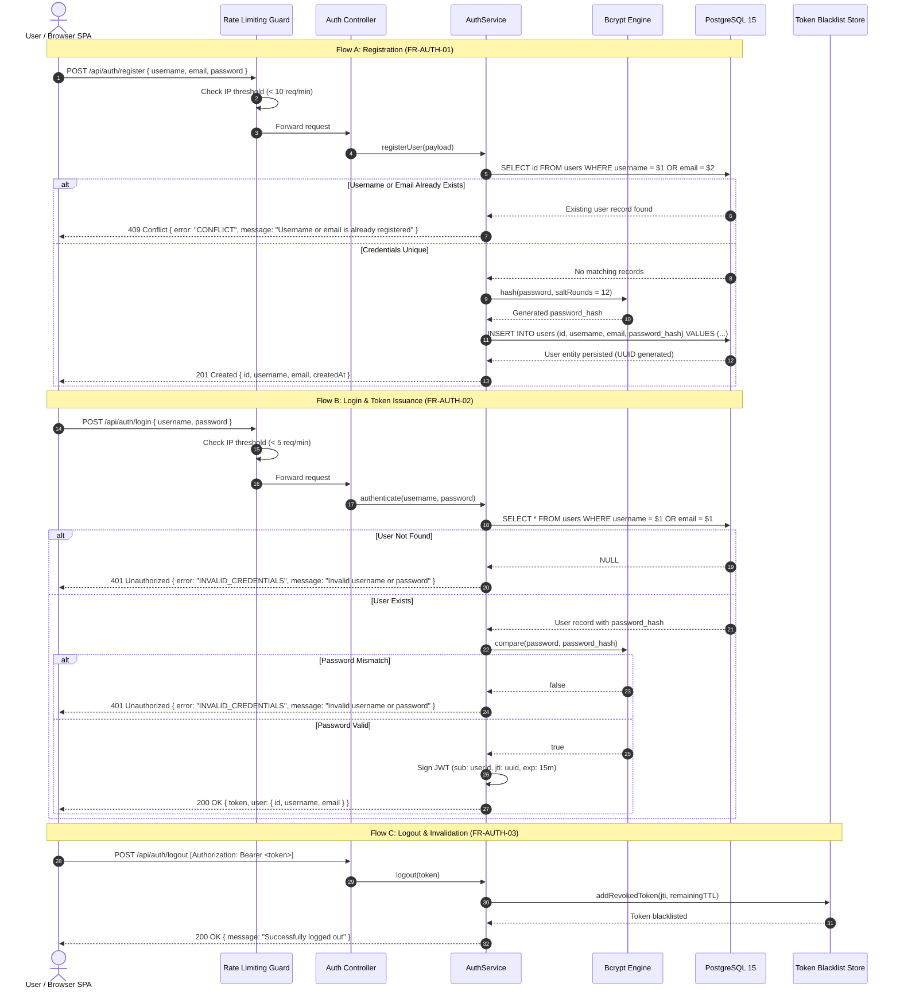
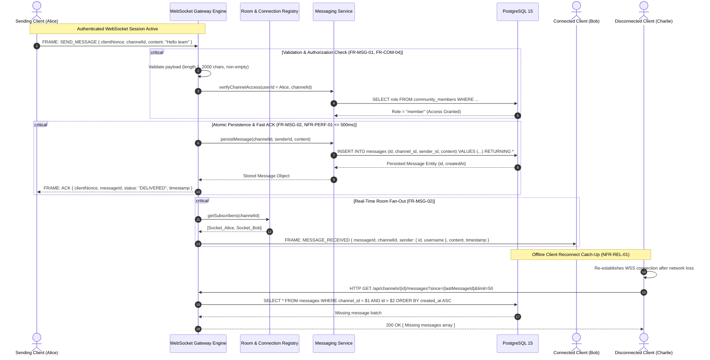

# Software Design Specification (SDS)
## NexusChat Real-Time Communication Platform
**Document Identifier:** SDS-NEXUS-01  
**Standard Compliance:** IEEE 1016-2009 (Standard for Information Technology — Systems Design — Software Design Descriptions)  
**Project:** SE Mini-Project Part 1 — Deliverable 3 (Part B: Design Specification)  
**Author:** Vishnu Anand (PES1UG24CS537)  
**Repository:** `VG776/SE-Jackfruit`  
**Target Branch:** `Vishnu-arch-design-docs`  
**Status:** Approved Draft  
**Date:** October 2026  

---

## 1. Introduction

### 1.1 Purpose
This Software Design Specification (SDS) provides the low-level architectural blueprints and interface contracts for the **NexusChat** collaborative messaging application. Formatted according to IEEE 1016-2009, this document translates the high-level components defined in the *Software Architecture Document (SAD)* into concrete runtime behaviors, UML sequence flows, RESTful endpoint specifications, WebSocket event protocols, and standardized error-handling procedures.

### 1.2 Scope
This specification governs the dynamic behavior, API surfaces, data exchange formats, and error pipelines for all functional subsystems:
- Identity and Profile Management (`FR-AUTH-01` through `FR-AUTH-04`)
- Community, Membership, and Channel Governance (`FR-COM-01` through `FR-COM-04`)
- Channel Messaging, Direct Messaging, and Presence (`FR-MSG-01` through `FR-MSG-05`)
- Reactions, Scoped Search, and Notifications (`FR-UX-01` through `FR-UX-03`)
- Moderation Controls and Immutable Audit Trails (`FR-MOD-01` through `FR-MOD-03`)
- System Performance, Safety, and Quality SLAs (SRS Section 6 and Section 7)

### 1.3 Definitions and Conventions
- **Endpoint Notation:** Standard HTTP methods (`GET`, `POST`, `PUT`, `PATCH`, `DELETE`) paired with resource paths prefixed by `/api`.
- **Payload Format:** JSON (JavaScript Object Notation) with UTF-8 encoding.
- **Timestamps:** ISO 8601 strings in Coordinated Universal Time (UTC), e.g., `"2026-10-13T12:00:00.000Z"`.
- **Identifiers:** Canonical UUIDv4 strings (e.g., `"123e4567-e89b-12d3-a456-426614174000"`).

### 1.4 References
1. *NexusChat Software Requirements Specification (SRS_document.md)* — Working Draft, October 2026.
2. *NexusChat Software Architecture Document (software_architecture_document.md)* — SAD-NEXUS-01, October 2026.
3. *RFC 7807: Problem Details for HTTP APIs*, IETF, 2016.
4. *RFC 6455: The WebSocket Protocol*, IETF, 2011.

---

## 2. Dynamic Behavior & UML Sequence Diagrams

### 2.1 Sequence Diagram 1: User Registration, Authentication & Token Invalidation
*Traceability: FR-AUTH-01, FR-AUTH-02, FR-AUTH-03, NFR-SEC-01, NFR-SEC-02, NFR-SEC-05, NFR-SEC-08*

This sequence illustrates the end-to-end lifecycle of guest registration, credential authentication, and secure session termination:



**Explanation:**
1. Registration verifies that both `username` and `email` are unique via indexed database lookup. Collisions return a specific 409 Conflict error without exposing private user metadata (`FR-AUTH-01`).
2. Passwords are never saved in plaintext; `bcrypt` hashes the credential with 12 salt rounds before database insertion (`NFR-SEC-01`).
3. Login failure uses a generic 401 error message to prevent account enumeration attacks (`FR-AUTH-02`).
4. On logout, the token's unique identifier (`jti`) is added to an in-memory/database revocation store until token expiration, ensuring absolute invalidation (`FR-AUTH-03`).

---

### 2.2 Sequence Diagram 2: Real-Time Channel Message Dispatch & Broadcast
*Traceability: FR-MSG-01, FR-MSG-02, FR-MSG-05, SRS 6.1 (NFR-PERF-01), NFR-REL-01*

This sequence illustrates the high-throughput message ingestion, relational persistence, instant acknowledgement ($\le 500	ext{ ms}$ p95), and room broadcasting:



**Explanation:**
1. Incoming frames undergo strict length validation ($1 \le 	ext{length} \le 2000$) and server-side membership validation before any write occurs (`FR-MSG-01`, `FR-COM-04`).
2. The database write uses a prepared parameterized query. The sender receives an immediate `ACK` frame within the required sub-500 ms p95 SLA containing the server-generated `messageId` and `clientNonce` for client-side deduplication (`NFR-PERF-01`).
3. The WebSocket Gateway broadcasts the payload only to active sockets subscribed to the target channel in the in-memory `RoomRegistry` (`FR-MSG-02`).
4. Reconnecting clients retrieve missed messages via the paginated REST historical endpoint using their local high-water mark ID (`since`), eliminating message loss (`NFR-REL-01`).

---

### 2.3 Sequence Diagram 3: Permission-Scoped Full-Text Message Search
*Traceability: FR-UX-02, SRS 6.1 (NFR-PERF-03), NFR-SEC-03, NFR-SEC-04*

This sequence illustrates the secure execution of full-text message search using PostgreSQL GIN indexing, strict community boundary enforcement, and sanitized snippet generation:

```mermaid
sequenceDiagram
    autonumber
    actor User as Authenticated Client
    participant RateLimiter as Rate Limiter (30 req/min)
    participant SearchRouter as Search Controller
    participant SearchService as Search Service
    participant QuerySanitizer as SQL & Lexeme Sanitizer
    participant DB as PostgreSQL 15 (GIN Index)

    User->>RateLimiter: GET /api/search?q=project+deadline&channelId=...&limit=20
    RateLimiter->>RateLimiter: Check user quota (< 30 req/min)
    RateLimiter->>SearchRouter: Forward request [req.user.id]

    critical Input Sanitization & Parameter Validation
        SearchRouter->>SearchService: executeSearch(userId, queryParams)
        SearchService->>QuerySanitizer: sanitizeQuery(q)
        QuerySanitizer-->>SearchService: Formatted tsquery string: "project & deadline"
    end

    critical Permission-Scoped Query Execution (FR-UX-02, <= 2s)
        SearchService->>DB: SELECT m.id, m.content, ts_headline(m.content, q) as snippet, ts_rank(m.search_vector, q) as rank FROM messages m JOIN channels c ON m.channel_id = c.id JOIN community_members cm ON c.community_id = cm.community_id WHERE cm.user_id = $1 AND m.search_vector @@ to_tsquery('english', $2) ORDER BY rank DESC, m.created_at DESC LIMIT $3 OFFSET $4
        Note over DB: GIN index scans matching lexemes; JOIN guarantees user is an authorized member
        DB-->>SearchService: Matching message rows with highlighted snippets
    end

    SearchService-->>SearchRouter: Standardized Search Result DTO
    SearchRouter-->>User: 200 OK { results: [...], totalCount: 14, page: 1, executionTimeMs: 42 }
```

**Explanation:**
1. The search query string is validated and sanitized to prevent SQL injection and full-text syntax parsing errors (`NFR-SEC-04`).
2. The search query enforces permission boundaries at the database level by joining the `community_members` table against `req.user.id`. Messages from private communities or channels the user has not joined are never scanned or returned (`FR-UX-02`).
3. PostgreSQL utilizes the `search_vector` column indexed with `GIN`, returning ranked (`ts_rank`) results and highlighted context snippets (`ts_headline`) well within the sub-2 second SLA (`SRS Section 6.1`).

---

## 3. API Design & Interface Specifications

### 3.1 REST API Overview & Global Conventions
- **Base Endpoint:** `http(s)://<domain>/api/v1`
- **Authentication Header:** `Authorization: Bearer <JWT_ACCESS_TOKEN>`
- **Content Type:** `application/json; charset=utf-8`
- **Pagination Convention:** Offset-based (`page=1&limit=20`) or cursor-based (`before=<uuid>&limit=50`).

### 3.2 Comprehensive REST Endpoint Catalog

| HTTP Method | Resource Path | Description | Request Parameters / Body | Response Status | Auth Required | Linked Req ID |
|---|---|---|---|---|---|---|
| **POST** | `/api/auth/register` | Register new user account | JSON: `{ username, email, password }` | `201 Created`, `400`, `409` | No (Guest) | `FR-AUTH-01` |
| **POST** | `/api/auth/login` | Authenticate user & issue JWT | JSON: `{ username, password }` | `200 OK`, `400`, `401` | No (Guest) | `FR-AUTH-02` |
| **POST** | `/api/auth/logout` | Revoke active session token | Empty body | `200 OK`, `401` | Yes (Bearer) | `FR-AUTH-03` |
| **GET** | `/api/users/me` | Fetch active user profile | None | `200 OK`, `401` | Yes (Bearer) | `FR-AUTH-04` |
| **PUT** | `/api/users/me` | Update user profile fields | JSON: `{ displayName, avatarUrl, status }` | `200 OK`, `400`, `401` | Yes (Bearer) | `FR-AUTH-04` |
| **POST** | `/api/communities` | Create community | JSON: `{ name, description }` | `201 Created`, `400`, `409` | Yes (Bearer) | `FR-COM-01` |
| **GET** | `/api/communities` | List joined communities | Query: `?page=1&limit=20` | `200 OK`, `401` | Yes (Bearer) | `FR-COM-02` |
| **POST** | `/api/communities/:id/invites` | Generate community invite link | JSON: `{ maxUses, expiresInHours }` | `201 Created`, `403` | Yes (Admin) | `FR-COM-02` |
| **POST** | `/api/invites/:code/join` | Join community via invite code | None | `200 OK`, `404`, `409` | Yes (Bearer) | `FR-COM-02` |
| **POST** | `/api/communities/:id/channels` | Create text channel | JSON: `{ name, type: "text" }` | `201 Created`, `400`, `403` | Yes (Admin) | `FR-COM-03` |
| **PATCH** | `/api/channels/:id` | Rename channel | JSON: `{ name }` | `200 OK`, `400`, `403` | Yes (Admin) | `FR-COM-03` |
| **DELETE** | `/api/channels/:id` | Delete channel (destructive) | Query: `?confirm=true` | `204 No Content`, `403` | Yes (Admin) | `FR-COM-03, SRS 6.2` |
| **GET** | `/api/channels/:id/messages` | Fetch channel message history | Query: `?before=<uuid>&limit=50` | `200 OK`, `403`, `404` | Yes (Member) | `FR-MSG-02` |
| **POST** | `/api/channels/:id/messages` | Send message (REST fallback) | JSON: `{ content, clientNonce }` | `201 Created`, `400`, `403` | Yes (Member) | `FR-MSG-01` |
| **PATCH** | `/api/messages/:id` | Edit message content | JSON: `{ content }` | `200 OK`, `403`, `404` | Yes (Author) | `FR-MSG-04` |
| **DELETE** | `/api/messages/:id` | Delete / tombstone message | None | `204 No Content`, `403` | Yes (Author/Mod)| `FR-MSG-04, FR-MOD-01` |
| **POST** | `/api/messages/:id/reactions` | Add reaction emoji to message | JSON: `{ emoji: "👍" }` | `200 OK`, `400`, `403` | Yes (Member) | `FR-UX-01` |
| **DELETE**| `/api/messages/:id/reactions/:emoji` | Remove reaction emoji | None | `204 No Content`, `404` | Yes (Member) | `FR-UX-01` |
| **POST** | `/api/direct-conversations` | Initiate 1-on-1 DM conversation | JSON: `{ recipientId }` | `200 OK`, `201 Created` | Yes (Bearer) | `FR-MSG-03` |
| **GET** | `/api/direct-conversations/:id/messages` | Retrieve DM message history | Query: `?before=<uuid>&limit=50` | `200 OK`, `403` | Yes (Participant) | `FR-MSG-03` |
| **GET** | `/api/search` | Permission-scoped full-text search| Query: `?q=&channelId=&page=&limit=` | `200 OK`, `400`, `401` | Yes (Bearer) | `FR-UX-02, SRS 6.1` |
| **POST** | `/api/communities/:id/members/:userId/moderation` | Restrict or kick member | JSON: `{ action: "KICK"|"BAN", reason }` | `200 OK`, `403`, `404` | Yes (Mod/Admin)| `FR-MOD-02, FR-MOD-03` |
| **GET** | `/api/communities/:id/audit-logs` | Retrieve moderation audit trail | Query: `?page=1&limit=50` | `200 OK`, `403` | Yes (Mod/Admin)| `FR-MOD-03` |

---

### 3.3 Sample Request & Response Payloads

#### 1. User Registration (`POST /api/auth/register`)
**Request Body:**
```json
{
  "username": "alice_dev",
  "email": "alice@example.com",
  "password": "SecurePassword123!"
}
```
**Success Response (`201 Created`):**
```json
{
  "status": "success",
  "data": {
    "id": "e2a1b9f4-18c3-4d62-8e12-70b9e8461011",
    "username": "alice_dev",
    "email": "alice@example.com",
    "displayName": "alice_dev",
    "createdAt": "2026-10-13T10:00:00.000Z"
  }
}
```
**Conflict Error Response (`409 Conflict`):**
```json
{
  "type": "https://nexuschat.internal/errors/conflict",
  "title": "Conflict",
  "status": 409,
  "code": "USER_ALREADY_EXISTS",
  "detail": "Username or email is already registered",
  "instance": "/api/auth/register"
}
```

#### 2. User Authentication (`POST /api/auth/login`)
**Request Body:**
```json
{
  "username": "alice_dev",
  "password": "SecurePassword123!"
}
```
**Success Response (`200 OK`):**
```json
{
  "status": "success",
  "data": {
    "token": "eyJhbGciOiJIUzI1NiIsInR5cCI6IkpXVCJ9...",
    "expiresIn": 900,
    "user": {
      "id": "e2a1b9f4-18c3-4d62-8e12-70b9e8461011",
      "username": "alice_dev",
      "displayName": "Alice",
      "email": "alice@example.com"
    }
  }
}
```

#### 3. Full-Text Search Query (`GET /api/search?q=docker+setup&limit=2`)
**Success Response (`200 OK`):**
```json
{
  "status": "success",
  "data": {
    "query": "docker setup",
    "totalMatches": 1,
    "page": 1,
    "limit": 2,
    "results": [
      {
        "id": "7f13b2c9-4a92-4f32-8e01-2a559d8fec18",
        "channelId": "09eb0011-b31b-45cc-a99a-78cf8062991f",
        "channelName": "dev-general",
        "communityId": "3a8df3d2-a9e5-42f2-a8b6-98dc44b08362",
        "communityName": "NexusChat Engineers",
        "sender": {
          "id": "e2a1b9f4-18c3-4d62-8e12-70b9e8461011",
          "username": "alice_dev"
        },
        "content": "Please verify your docker setup before testing the build.",
        "snippet": "Please verify your <b>docker</b> <b>setup</b> before testing the build.",
        "rank": 0.824,
        "createdAt": "2026-10-13T10:15:30.000Z"
      }
    ],
    "executionTimeMs": 38
  }
}
```

#### 4. Audit Log Retrieval (`GET /api/communities/:id/audit-logs`)
**Success Response (`200 OK`):**
```json
{
  "status": "success",
  "data": {
    "communityId": "3a8df3d2-a9e5-42f2-a8b6-98dc44b08362",
    "logs": [
      {
        "id": "8cc08d40-55a5-4b7f-9264-e2f6ef41a3f2",
        "actor": {
          "id": "e2a1b9f4-18c3-4d62-8e12-70b9e8461011",
          "username": "alice_admin"
        },
        "action": "CHANNEL_DELETE",
        "targetType": "CHANNEL",
        "targetId": "4c2a719f-66f1-4c86-a818-bc3df3a33834",
        "details": {
          "channelName": "deprecated-random",
          "reason": "Archived inactive channel"
        },
        "createdAt": "2026-10-13T10:30:00.000Z"
      }
    ]
  }
}
```

---

### 3.4 WebSocket Event Protocol & Envelope Specification

All real-time communications adhere to a versioned, structured JSON envelope:

```typescript
interface WebSocketEnvelope<T> {
  event: string;          // Name of the event
  correlationId?: string; // Client nonce for tracking acks
  timestamp: string;      // ISO 8601 UTC timestamp
  payload: T;             // Typed event data
}
```

#### Event Catalog:
1. **`JOIN_CHANNEL` (Client -> Server):**
   - Payload: `{ "channelId": "uuid" }`
   - Purpose: Registers the client socket into the specific channel room.
2. **`SEND_MESSAGE` (Client -> Server):**
   - Payload: `{ "channelId": "uuid", "content": "text", "clientNonce": "nonce-123" }`
   - Purpose: Dispatches message for persistence and fan-out.
3. **`ACK` (Server -> Client):**
   - Payload: `{ "clientNonce": "nonce-123", "messageId": "uuid", "status": "DELIVERED" }`
   - Purpose: Sent within $\le 500	ext{ ms}$ p95 to verify message receipt and database commit.
4. **`MESSAGE_RECEIVED` (Server -> Client):**
   - Payload: `{ "id": "uuid", "channelId": "uuid", "sender": { "id": "uuid", "username": "alice" }, "content": "Hello", "createdAt": "timestamp" }`
   - Purpose: Broadcasts new message to room subscribers.
5. **`TYPING_START` / `TYPING_STOP` (Client <-> Server):**
   - Payload: `{ "channelId": "uuid", "userId": "uuid", "username": "alice" }`
   - Purpose: Ephemeral typing presence indication; auto-cleared after 3 seconds.
6. **`USER_PRESENCE_CHANGED` (Server -> Client):**
   - Payload: `{ "userId": "uuid", "status": "ONLINE" | "IDLE" | "OFFLINE" }`
   - Purpose: Dispatched to mutual community members upon connection or heartbeat lapse.

---

## 4. Error Handling Framework

### 4.1 Error Taxonomy & Classification
The application categorizes runtime errors into five distinct domains:
1. **Client Schema & Input Errors (400 Bad Request):** Payload fails declarative schema validation (missing required fields, out-of-range string lengths).
2. **Security & Authentication Errors (401 Unauthorized, 403 Forbidden):** Missing/invalid JWT token or insufficient community role permissions.
3. **Resource State & Conflict Errors (404 Not Found, 409 Conflict):** Resource non-existent or duplicate unique key constraint violation.
4. **Rate Limit & Abuse Errors (429 Too Many Requests):** Quota exceeded for IP or authenticated account.
5. **Infrastructure & Internal Server Errors (500 Internal Server Error, 503 Service Unavailable):** Database pool exhaustion, query failures, or unexpected process exceptions.

### 4.2 Standard Error Response Format (RFC 7807)
All REST error responses adhere to the RFC 7807 problem details specification:

```json
{
  "type": "https://nexuschat.internal/errors/validation-error",
  "title": "Bad Request",
  "status": 400,
  "code": "INVALID_INPUT_PAYLOAD",
  "detail": "Field 'content' must not exceed 2000 characters",
  "instance": "/api/channels/123/messages",
  "invalidParams": [
    {
      "name": "content",
      "reason": "Length must be less than or equal to 2000 characters"
    }
  ]
}
```

### 4.3 HTTP Status Code Mapping Matrix

| HTTP Status Code | Application Code | Condition / Trigger | User-Facing Message |
|---|---|---|---|
| **400 Bad Request** | `INVALID_INPUT_PAYLOAD` | Schema validation failure | "Please check your input and try again." |
| **401 Unauthorized**| `TOKEN_EXPIRED` / `INVALID_CREDENTIALS` | Missing or expired token; bad password | "Session expired or invalid credentials. Please log in." |
| **403 Forbidden**   | `INSUFFICIENT_PERMISSIONS` | Role lacks required permission | "You do not have permission to perform this action." |
| **404 Not Found**   | `RESOURCE_NOT_FOUND` | Channel or community does not exist | "The requested resource could not be found." |
| **409 Conflict**    | `RESOURCE_ALREADY_EXISTS` | Duplicate username, email, or community name | "A resource with these details already exists." |
| **429 Too Many Req**| `RATE_LIMIT_EXCEEDED` | Quota exceeded | "Too many requests. Please wait a moment before retrying." |
| **500 Internal Err**| `INTERNAL_SERVER_ERROR` | Uncaught exception; DB error | "An unexpected error occurred. Please try again later." |
| **503 Unavailable** | `DATABASE_UNAVAILABLE` | Connection pool timeout | "Service temporarily unavailable. Please retry shortly." |

### 4.4 Logging, Secret Redaction & Retry Strategy
1. **Redaction Pipeline (SRS Section 6.3, NFR-SEC-08):** Centralized error middleware inspects all logged payloads. Keys matching regex `/(password|token|secret|authorization|cookie)/i` are replaced with `"[REDACTED]"`.
2. **Stack Trace Masking:** In non-development environments, error stack traces are written to internal operational logs with a generated error tracking UUID (`correlationId`) and omitted from the client JSON response.
3. **Client Retry Strategy (NFR-REL-01):**
   - For network disconnection: Client attempts exponential backoff reconnects at intervals of 1s, 2s, 4s, 8s, up to 30s.
   - For idempotent `GET` requests encountering 503: Max 3 automatic retries with jitter.
   - For mutations (`POST` messages): Re-submission must reuse the original `clientNonce` to prevent duplicated database writes.

---

## 5. Module Interfaces & Internal Contracts

Internal domain modules communicate via strongly-typed JavaScript interfaces:

### 5.1 Service Interface Signatures
```javascript
// Identity Service (Varshit)
interface IAuthService {
  register(userData): Promise<{ user: UserDTO }>;
  authenticate(username, password): Promise<{ token: string, user: UserDTO }>;
  revokeToken(jti: string, ttlSeconds: number): Promise<void>;
  updateProfile(userId: string, updates: ProfileDTO): Promise<UserDTO>;
}

// Community & Channel Service (Pranav)
interface ICommunityService {
  createCommunity(userId: string, name: string, desc: string): Promise<CommunityDTO>;
  createChannel(userId: string, communityId: string, channelName: string): Promise<ChannelDTO>;
  verifyPermission(userId: string, communityId: string, requiredPermission: string): Promise<boolean>;
  deleteChannel(userId: string, channelId: string): Promise<void>;
}

// Search & Quality Service (Vishnu)
interface ISearchService {
  searchMessages(userId: string, query: string, filters: SearchFilters): Promise<SearchResultDTO>;
}

// Moderation & Audit Service
interface IModerationService {
  removeMessage(actorId: string, messageId: string, reason: string): Promise<void>;
  recordAuditEvent(communityId: string, actorId: string, action: string, targetId: string, details: object): Promise<void>;
}
```

---

## 6. Design Decisions, Performance Considerations & Open Issues

### 6.1 Key Design Decisions & Technical Rationale
1. **Dual Protocol Architecture (REST + WebSockets):** REST is selected for transactional, idempotent CRUD operations (registration, community settings, audit logs) benefiting from standard HTTP caching and semantics. WebSockets are reserved for duplex, latency-critical streams (chat messages, typing indicators, presence, reactions) to eliminate connection handshake latency.
2. **PostgreSQL GIN Indexing over External Search Engine:** Native PostgreSQL `tsvector` with Generalized Inverted Indexes (GIN) fulfills the sub-2 second search requirement (`SRS Section 6.1`) without the operational complexity, memory overhead, and data synchronization issues of maintaining a separate Elasticsearch or Meilisearch cluster.
3. **Client Nonce Deduplication:** Every message dispatched from the client includes a unique UUID `clientNonce`. If network latency delays the server ACK and the client retransmits, the unique index on `(channel_id, client_nonce)` rejects the second write gracefully, guaranteeing idempotency (`NFR-REL-01`).

### 6.2 Performance & Scalability Tactics
- **Sub-500 ms WebSocket Acknowledgements:** Minimized database transaction scope, pre-compiled parameterized SQL prepared statements, and asynchronous room fan-out after database commit.
- **Sub-2 Second Search Latency:** Automatic PostgreSQL database trigger generating lexemes on message insert/update; query optimization using `to_tsquery('english', $1)` against indexed columns.
- **Connection Resource Protection:** PostgreSQL connection pooling bounded between 10 (minimum idle) and 20 (maximum active) connections; reverse proxy connection buffering.

### 6.3 Open Issues & Future Extensibility
- **File & Media Storage:** The MVP scope is restricted to plain text messaging. Future increments will incorporate S3-compatible object storage and presigned URLs for media attachments.
- **Horizontal Clustering:** For multi-instance horizontal scaling beyond a single Node.js container, a Redis Pub/Sub adapter (e.g., `@socket.io/redis-adapter`) can be attached to the WebSocket Gateway without altering client contracts.

---

*Document compiled in compliance with IEEE Std 1016-2009 for NexusChat Deliverable 3.*
